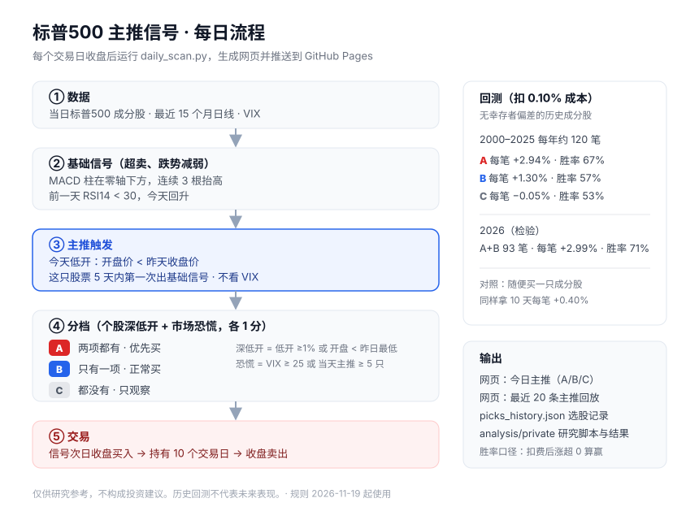

# S&P 500 Daily Signal Scanner

每个交易日收盘后扫描标普500 全部成分股，按「主推」规则选出超卖后恐慌低开的股票，分 A/B/C 三档，生成网页并发布到 GitHub Pages。

**网站：** https://fengkaitian.github.io/chucun_scan/

---

## Pipeline



---

## 文件说明

| 文件 | 说明 |
|---|---|
| `daily_scan.py` | 主扫描脚本，运行后生成报告并推送到 GitHub Pages |
| `report_v2.py` | 网页模板（今日主推 + 最近 20 条主推回放 + 规则与回测） |
| `report.py` | 旧版网页模板（`python daily_scan.py --old-page`） |
| `forward_track.py` | 深跌规则的前瞻记录（`--asof 日期` 可补跑漏掉的一天） |
| `analysis/private/` | 研究脚本和回测结果（2000–2026，无幸存者偏差数据） |
| `picks_history.json` | 选股记录（每日扫描自动追加，页面的实际表现从这里算） |
| `backfill.py` | 扫描停跑后补算缺失日子的选股：`python backfill.py` |
| `loop_scan.py` | 定时脚本，每天 04:30 AM 自动触发 |
| `validated_combos.json` | 经6年回测验证的206种信号组合定义 |
| `run_scan.bat` | 手动运行入口 |
| `index.html` | 最新报告（自动生成，每日覆盖） |

---

## 运行方式

**手动运行一次：**
```
python daily_scan.py
```

**只在本地生成报告，不推送、不自动开浏览器：**
```
python daily_scan.py --no-push --no-open
```

**开启每日 04:30 AM 自动扫描：**
```
python loop_scan.py
```

---

## 选股逻辑（2026-11-19 起）

**主推规则**：同时满足以下几条
1. MACD 柱在零轴下方，连续 3 根抬高（跌势减弱）
2. 前一天 RSI14 < 30，今天回升
3. 今天低开：开盘价 < 昨天收盘价
4. 这只股票 5 天内第一次出现 1、2 两条；不看 VIX

**操作**：信号次日收盘买入，持有 10 个交易日后收盘卖出。

**分档**：个股深低开（低开 ≥1% 或开盘 < 昨日最低）、市场恐慌（VIX ≥ 25 或当天主推 ≥ 5 只）各 1 分。

| 档 | 条件 | 每年约 | 每笔净收益 | 胜率 | 2026 |
|---|---|---|---|---|---|
| **A** 优先买 | 两项都有 | 29 | +2.94% | 67% | +2.46% · 69% |
| **B** 正常买 | 只有一项 | 49 | +1.30% | 57% | +3.20% · 72% |
| **C** 只观察 | 都没有 | 41 | −0.05% | 53% | +1.60% · 57% |

回测：2000–2025 年训练、2026 年检验；数据为无幸存者偏差的历史成分股；扣 0.10% 来回成本，扣费后涨超 0 算赢。对照：随便买一只成分股持有 10 天每笔 +0.40%。

旧的 SSS/S/A/B 组合评级和 ★ 星级已停用（代码保留），复查结论见 `analysis/private/`。

> 仅供研究参考，不构成投资建议。历史回测不代表未来表现。
